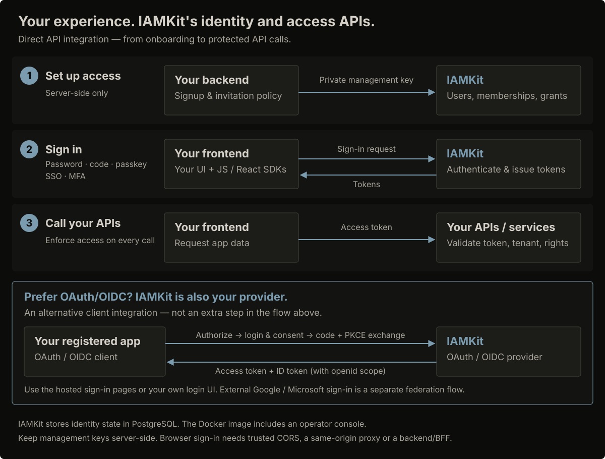

# Integrate your application

Your application owns business data and onboarding policy; IAMKit owns identity
state and scoped sessions. Your API enforces access to that data. Choose how to
connect sign-in before deciding which screens to build.

## Choose your integration

| Your goal | Integration |
| --- | --- |
| Ship sign-in without building authentication forms | [Hosted sign-in](hosted-login.md), using OAuth authorization code + PKCE |
| Own the authentication UI | [Custom sign-in UI](custom-sign-in-ui.md), with the browser client or React components |
| Connect a standards-based client | [OAuth and OpenID Connect](oauth-oidc.md) or [SAML applications](saml-apps.md) |

For browser apps, decide whether the browser will receive tokens or a backend
for frontend (BFF) will keep them server-side. The choice affects token storage,
not the permissions your API must check.

## Recommended sequence

1. [Provision an application](../../start/first-application.md): create an environment, organization, API resource and application-resource binding.
2. Choose [onboarding](../sign-in/signup-and-onboarding.md). Self-service sign-up is opt-in and uses the configured sign-up organization; use invitations or backend provisioning when your application decides eligibility or tenant placement.
3. Configure [hosted sign-in](hosted-login.md) or a [custom UI](custom-sign-in-ui.md). Use authorization code + PKCE for an OAuth integration.
4. [Protect your API](../../start/protect-an-api.md): validate the token's audience, organization and permissions, then scope data queries to that organization.
5. Test both allowed and denied access, session refresh and logout.

Administrative onboarding calls belong on your backend. A management key carries
workspace authority; a [scoped IAM token](../../reference/api/scoped-iam.md)
limits calls to its environment and IAM permissions. Neither belongs in a public
sign-up form. Expose policy-checked operations, not a generic management proxy,
and do not trust organization or role choices supplied by the browser.

## Browser versus BFF

Direct integration returns tokens to your browser code. Keep them in memory,
minimize script exposure and define reload/refresh behavior. A BFF can keep refresh
tokens server-side and issue its own Secure HttpOnly cookie, with CSRF protection.
Neither approach makes CORS an authorization control. Same-origin proxying is
simpler for cookie-bound federation/OAuth; credentialed cross-origin access must
use a tightly controlled allowlist.

For a custom browser UI, use the [federation return flow](../enterprise/federation.md)
with `return_to` and a PKCE challenge: IAMKit redirects with a one-time result
handle, which your client redeems. Hosted OAuth sign-in instead returns an
authorization code to the registered callback. Preserve the browser-binding
cookie and never put access or refresh tokens in query strings.

## Next steps

Build [hosted sign-in](hosted-login.md) or a [custom UI](custom-sign-in-ui.md),
then test your backend with [protect an API](../../start/protect-an-api.md).
